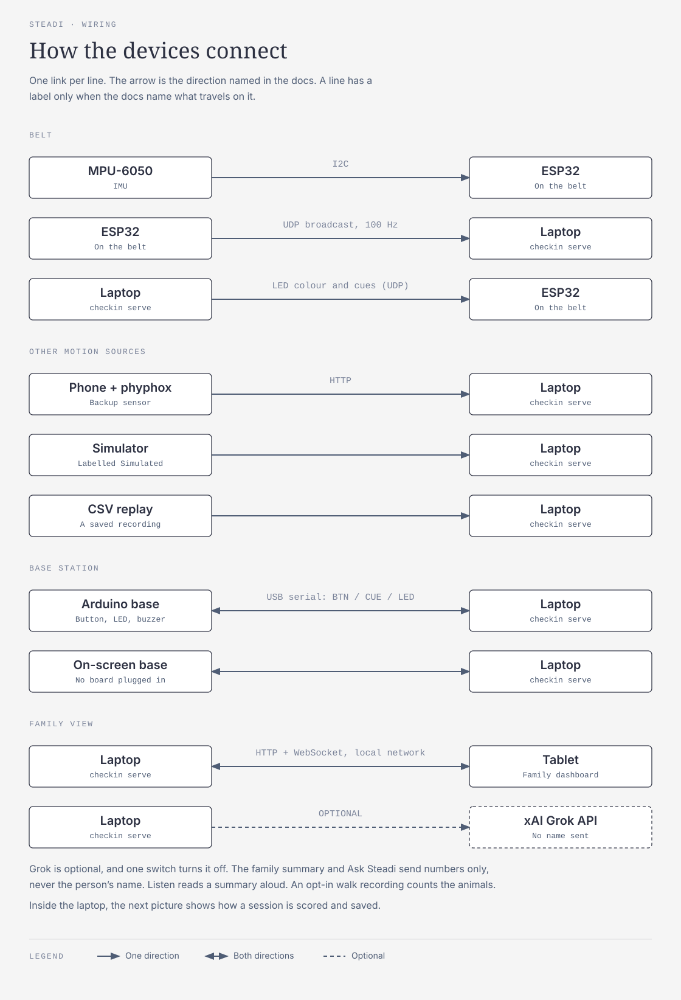
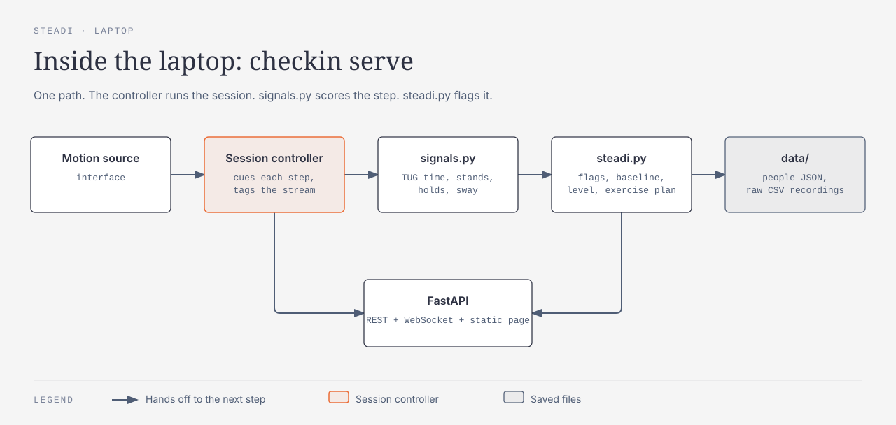

# Steadi

A lower-back motion belt, a one-button base station, and a family dashboard that run the CDC's STEADI fall-risk screening at home, then coach the follow-up exercises and count the reps.

Steadi is fall-risk screening: it flags increased fall risk and tracks change from baseline. It does not diagnose anything, predict when someone will fall, or guarantee prevention, and the device has not been through a trial.

A public demo runs on the simulator at [dhsquad.onrender.com](https://dhsquad.onrender.com), and the [quick start](#quick-start-no-hardware) runs the same thing locally with no hardware.

## The problem

- About 1 in 4 U.S. adults aged 65 and older report a fall each year (14 million+), and falls are the leading cause of injury death in that age group ([CDC](https://www.cdc.gov/falls/)).
- Alert pendants and watch fall detection only act after a fall, and often go unused. In a UK cohort of people over 90, the person had a call alarm in 99% of falls where they were alone and couldn't get up, but didn't use it in 80% of those falls ([Fleming & Brayne, BMJ 2008](https://doi.org/10.1136/bmj.a2227)).
- The CDC already has a prevention playbook, [STEADI](https://www.cdc.gov/steadi/): screen with three key questions, assess gait, strength and balance with the Timed Up and Go, the 30-second chair stand and the 4-stage balance test, then intervene, including exercise. It is built for a clinic visit, so at home it rarely happens and nobody tracks it between visits.
- Exercise works. A Cochrane review of 108 trials (23,407 people, average age 76) found exercise reduces the rate of falls by about 23%, with high-certainty evidence ([Sherrington et al. 2019](https://doi.org/10.1002/14651858.CD012424.pub2)). A pamphlet doesn't tell the family whether the exercises happened.

Steadi runs every STEADI stage at home. The older adult only has to press one button while the base station beeps each cue, and the belt counts the exercise reps so the family can see they were done.

## What it does

| STEADI stage | In the product | How it's measured |
|---|---|---|
| Screen | The three key questions (fallen in the past year? unsteady? worried about falling?) in the profile | "Yes" to any is a flag |
| Assess | A guided check-in of about 3 minutes, with a family member standing by as STEADI requires: Timed Up and Go, the same walk while naming animals (dual-task), 30-second chair stand, and balance stances (feet together, semi-tandem, tandem, 10 s each) | Lower-back sensor: TUG time to sit-down, stands counted, hold time and sway per stance. Flags: TUG ≥ 12 s, chair stands below the STEADI average for age and sex, tandem < 10 s. Dual-task cost is tracked against the person's baseline |
| Intervene | Exercise mode: sit-to-stand sets (a beep per rep) and counter-supported balance holds. The plan leans on the weakest area and steps up after enough exercise days | The same sensor counts reps and times holds |
| Track | Family dashboard: fall-risk level (green, amber or red, our own summary of the STEADI flags), trends, change from baseline, exercise adherence, and when to mention it to a doctor | Rolling baseline of recent check-ins; a sustained decline is flagged even without a STEADI flag |

The dashboard has three views. Home is plain words for the family, Check-in shows full-screen step prompts with instruction pictures, and For the doctor has every number, the flags, trends, and a printable plain-text summary.

For safety, balance is done beside a counter, with no single-leg or eyes-closed stances. The chair stand stops and records 0 if arms are needed (the STEADI rule). The base-station button is a stopwatch fallback if sit-down detection misses, and solo exercise is limited to supported moves.

## How it works

| Part | What it is | Role |
|---|---|---|
| Belt | ESP32 + MPU-6050 (6-axis IMU) on an elastic belt at the lower back, USB power bank | Streams accelerometer and gyroscope at 100 Hz over Wi-Fi as UDP broadcast. Its RGB LED shows the check-in state, and its buzzer plays the cues (including a sway warning and a loss-of-balance alarm) without stopping the sensor stream |
| Base station | Arduino (Uno R4 or Nano) with a push button, RGB LED and passive buzzer | The only thing the older adult touches: button to start each step, beeps for "Go", stop and each rep, LED for the result |
| Laptop | Runs `checkin serve` | Session controller, scoring, storage, web server |
| Tablet | Any browser on the same network | Family dashboard |
| Backup sensor | A phone in a belt pouch running phyphox | Drop-in replacement for the belt |

Every device sits behind an interface, so the simulator and an on-screen base station stand in for anything not plugged in.





- The laptop is the session controller. For each step it sends the "Go" cue to the base station, tags the incoming motion stream with the step, scores the step when it ends, and pushes live state to the dashboard over a WebSocket.
- Timing starts on the "Go" cue, as in the clinical protocol, so the sensor only has to detect the end: the final sit-down (trunk pitch settles and motion stops) for the TUG, rise cycles for chair stands and sit-to-stands, and a departure from the stance posture for balance. Scoring thresholds are named constants at the top of [`src/checkin/signals.py`](src/checkin/signals.py).
- Scores are whole-step totals, so the belt, the phone and the button don't need sub-second clock alignment.
- It runs locally. Chart.js and the font are vendored, data is JSON files rather than a database, and the dashboard works on an offline access point.
- Every session's raw stream is saved to `data/recordings/`, so a session can be re-scored after tuning (`checkin replay`) or played back through the live dashboard.

### Grok (xAI) features

All of these are optional. They need `XAI_API_KEY`, and with no key, no internet, `CHECKIN_AI=off`, or the dashboard's "Turn Grok off" switch, nothing leaves the laptop and the rest of the app works the same.

- Family summary. "Make a summary" sends the doctor summary (numbers only, never the person's name) to a Grok model (`grok-4.3` by default, `CHECKIN_GROK_MODEL` to change it) and asks for 3 to 5 plain sentences. The reply is shown, labelled AI-written, only if it passes the checks in [`src/checkin/summary.py`](src/checkin/summary.py): no diagnosis, prediction or guarantee wording, no medical or medication advice, no clinical jargon, and no number that isn't in the recorded data. Otherwise the family gets a fixed-template summary.
- Ask Steadi. A question box on Home. Grok answers in 1 to 3 sentences from the same summary text, under the same checks. Questions that ask for a prediction, diagnosis or medical advice are never sent; they get "I can only answer from the check-in results" plus the fixed-wording summary.
- Spoken cues and Listen. The check-in screen reads each instruction aloud. [`scripts/make_voice.py`](scripts/make_voice.py) generates the cues once with xAI text to speech into `src/checkin/static/audio/` so they play offline; any cue without a file is read by the browser's own voice. Speech never starts or stops a timer. "Listen" reads the family summary in the Grok voice (cached in `data/audio/`). `CHECKIN_VOICE` picks the voice (default `carina`).
- Animal count. On the dual-task walk, with the family's opt-in, Grok speech to text counts the animals named. The count never changes a score.
- Instruction pictures. The pictures on the check-in screen were generated with Grok Imagine by [`scripts/make_images.py`](scripts/make_images.py) and are committed, so they need no network at run time.

```bash
uv run python scripts/make_voice.py --dry-run   # the cues it would make, and the cost (18 cues, about $0.04)
XAI_API_KEY=... uv run python scripts/make_voice.py
```

## Tech stack

| Layer | Choice |
|---|---|
| Server | Python 3.11, FastAPI + Uvicorn, WebSocket for live state, NumPy for signal processing, pyserial for the base station |
| Frontend | One static page: vanilla HTML/JS, vendored Chart.js 4.5.1 and Archivo font (OFL), no build step |
| Storage | JSON files per person and CSV recordings in `data/` (git-ignored) |
| Firmware | Arduino sketches built with `arduino-cli`: ESP32 belt (UDP), Arduino base station (serial) |
| AI (optional) | xAI Grok chat completions, text to speech, speech to text, and Grok Imagine (pictures generated ahead of time) |
| Tooling | uv, pytest, ruff |
| Showreel | [Remotion](https://www.remotion.dev) video in [`showreel/`](showreel/) |

## Quick start (no hardware)

Needs [uv](https://docs.astral.sh/uv/) (it fetches Python 3.11 if needed).

```bash
uv sync
uv run checkin serve --source sim --base virtual
```

Open http://localhost:8000, or http://LAPTOP-IP:8000 from a tablet on the same network. Everything the simulated sensor produces is labelled "Simulated" on screen, in charts and in summaries.

1. See a flag and the recovery. Pick the simulated example person in the person menu. Eight weeks of simulated check-ins show chair stands slipping from 13 to 10, two amber check-ins, an exercise plan, adherence going up to 5 days a week, and scores recovering. The history is generated on first run so it ends today (`uv run checkin seed` regenerates it).
2. Run a check-in. Pick Guest, set age and sex in Edit profile, press Start check-in, then "We're ready: start". Press "I'm ready" (the on-screen base-station button) at each step; the simulator acts out the step and the page plays the buzzer tones.
3. Exercise mode. "Start quick exercise" runs 5 sit-to-stands, with a beep and a count per rep.
4. Summaries. "Make a summary" writes one for the family and one for the doctor.

## Running on hardware

```bash
uv run checkin serve --source udp --base serial --serial-port /dev/cu.usbmodem1101
```

Wiring diagrams, firmware upload steps, every sensor and base-station combination, the phone backup, replaying recordings and the Render deploy are in [`docs/HARDWARE.md`](docs/HARDWARE.md). Parts, pins and power are in [`docs/PARTS_LIST.md`](docs/PARTS_LIST.md), and the serial and UDP line formats in [`firmware/PROTOCOL.md`](firmware/PROTOCOL.md). The serial port, UDP port (default 4210) and Wi-Fi credentials are settings (flags, environment variables, or `firmware/esp32_imu/secrets.h`), never hard-coded.

## Development

```bash
uv run pytest
uv run ruff check .
uv run checkin replay data/recordings/FILE.csv --age 72 --sex female   # re-score a saved session
```

The test suite includes a full simulated check-in scored against the simulator's true values.

To check the belt against a stopwatch and hand counts, follow [`docs/VALIDATION.md`](docs/VALIDATION.md), then:

```bash
uv run checkin validate --template                              # blank rows in data/validation/ground_truth.csv
uv run checkin validate data/validation/ground_truth.csv        # agreement charts in data/validation/report/
uv run checkin validate --simulated                             # preview on simulated data (labelled Simulated)
```

## Repo layout

```
src/checkin/
  cli.py          checkin serve | replay | seed | validate
  server.py       FastAPI app: REST API, WebSocket, static page
  controller.py   session controller: steps, cues, button, live state
  signals.py      step scoring from the IMU stream (thresholds at the top)
  steadi.py       STEADI flags, cutoffs, baseline, level, exercise plan, adherence
  sources.py      motion sources: sim, csv replay, udp (ESP32), phyphox
  base.py         base stations: virtual (on-screen) and serial (Arduino)
  sim.py          simulated lower-back IMU with known true scores
  seed.py         the simulated eight-week example history
  store.py        people JSON and CSV recordings
  ai.py           the one on/off switch for every Grok call
  summary.py      doctor summary, family summary (Grok with checks, or template), Ask Steadi
  animals.py      animals named on the dual-task walk (Grok speech to text, then a local word list)
  voice.py        spoken cues and Listen (xAI text to speech, cached)
  validate.py     belt vs stopwatch/hand count: ground-truth CSV, agreement stats
  report.py       validation charts (SVG, PNG) and an offline HTML report
  static/         index.html, app.js, instruction pictures, vendored Chart.js and font
firmware/
  esp32_imu/      belt: MPU-6050 over I2C, UDP broadcast, status LED and buzzer
  base_station/   Arduino: button, RGB LED, buzzer over USB serial
  imu_test/       bare MPU-6050 wiring check
  phyphox/        phone backup experiment (accelerometer + gyroscope at 100 Hz)
  PROTOCOL.md     serial and UDP line formats
docs/
  HARDWARE.md     running on real devices
  PARTS_LIST.md   parts, wiring, power
  API.md          REST and WebSocket API used by the page
  VALIDATION.md   protocol for checking the belt against a stopwatch
  diagrams/       device and wiring diagrams (SVG)
scripts/
  make_images.py  regenerate the instruction pictures with Grok Imagine
  make_voice.py   generate the spoken cues with xAI text to speech
showreel/         Remotion video of the product
tests/            pytest suite
```

## Status and limitations

This is a prototype.

- Agreement with a stopwatch and hand counts on real people has not been measured yet. `checkin validate` and the protocol in `docs/VALIDATION.md` are ready for it. The automated tests run against the simulator.
- No trial of this device exists. The exercise evidence comes from structured programs; the coached subset (sit-to-stands, supported balance holds) is the same type of exercise but untested as a program.
- The scoring approach follows a 2024 lower-back IMU study (Archives of Gerontology and Geriatrics Plus) that matched human raters within about 4% on the TUG and 8% on chair stands. Balance timing agreed least well in that study, so balance is Steadi's least certain score.
- The spoken-cue audio files are not committed yet, so until `scripts/make_voice.py` is run with a key the cues use the browser's voice.
- The animal count is opt-in and needs the laptop browser at `http://localhost:8000` with a close mic, since a tablet opened over the LAN cannot use the microphone. The simulator can play a bundled sample clip instead (labelled Simulated). It has only been tested with that sample and mocked speech to text.
- STEADI chair-stand norms start at age 60, so younger people are compared with the 60 to 64 line, labelled "the youngest STEADI group" on the dashboard.

## Team

Kevin Yin · Allen Hsieh

Clinical tests and cutoffs: CDC [STEADI](https://www.cdc.gov/steadi/). Charts: [Chart.js](https://www.chartjs.org/) (MIT). Font: Archivo (SIL Open Font License, `src/checkin/static/vendor/archivo-OFL.txt`).
