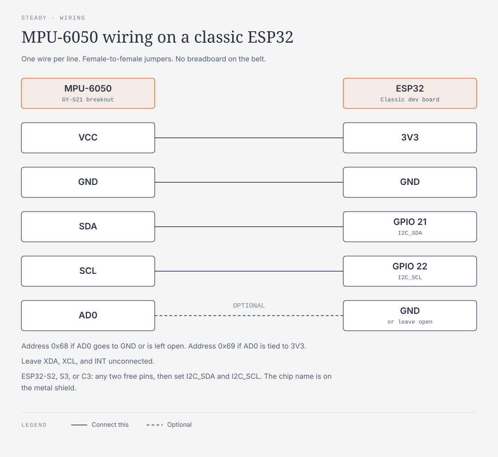
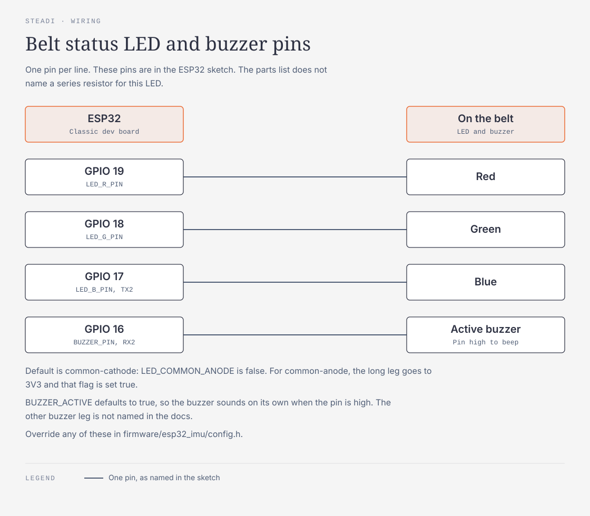
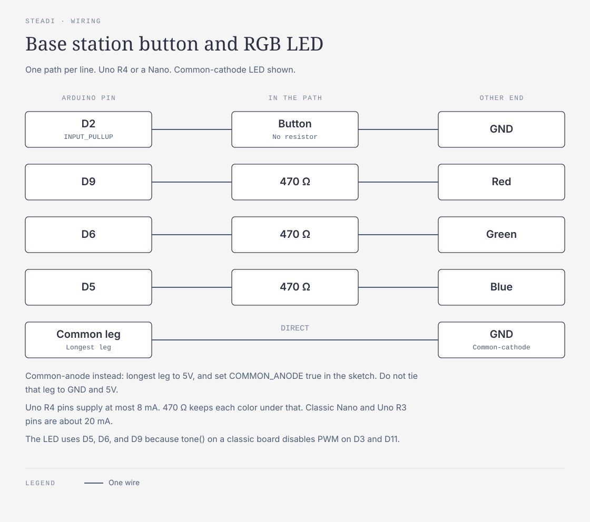
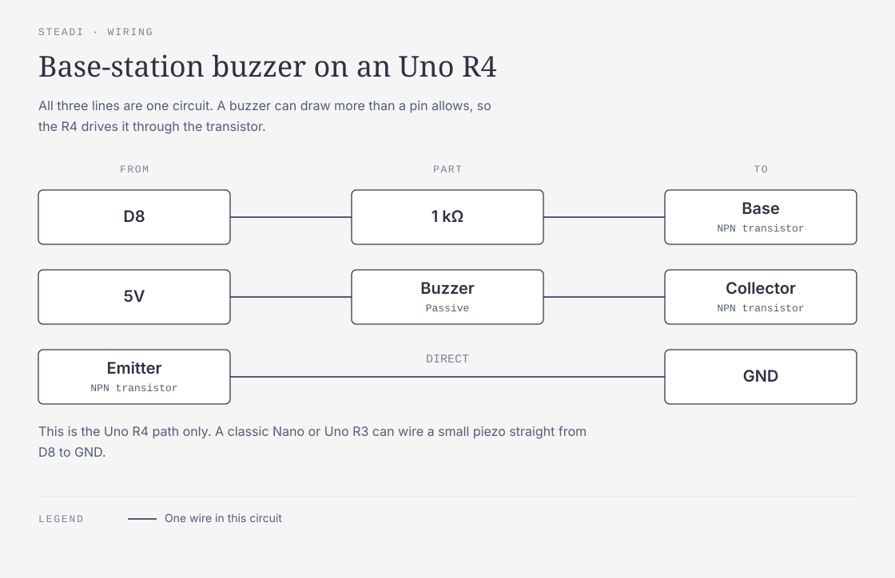
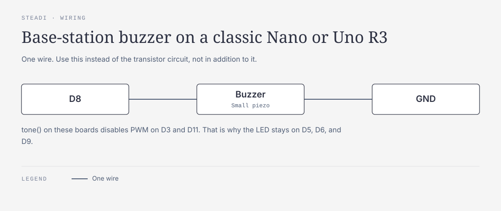
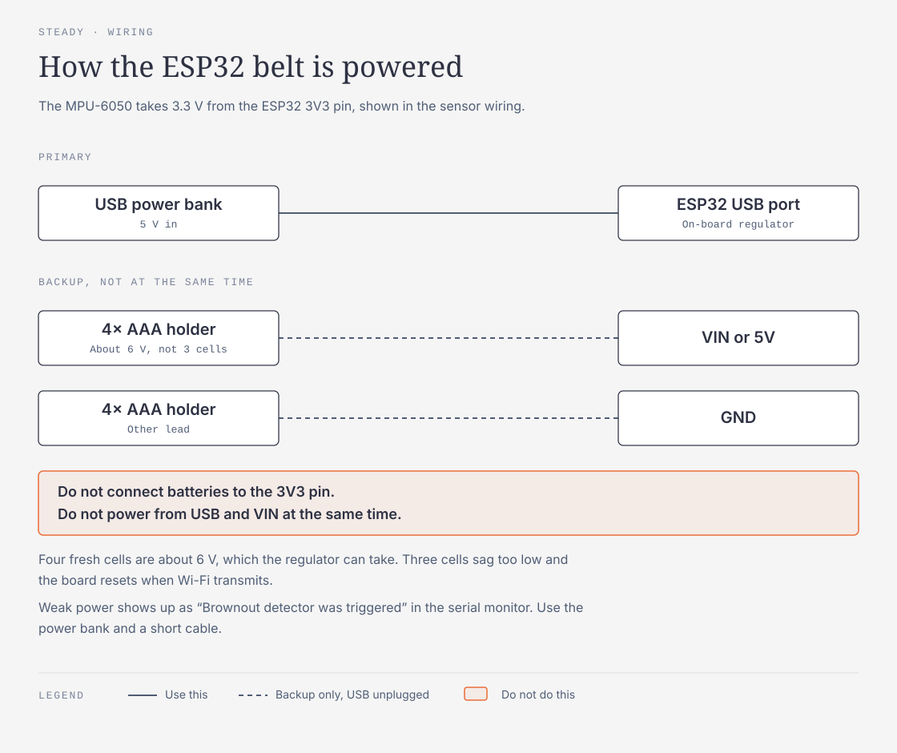

# Parts list

Everything in the build: the belt, the base station, the laptop and tablet, and the test station. Pins and power are below; setup steps are in `HARDWARE.md`.

---

## 1. Belt Unit (worn at the lower back)

| Part | Qty | Notes |
|---|---|---|
| ESP32 dev board | 1 (+1 spare) | Reads the sensor, streams over Wi-Fi |
| MPU-6050 (GY-521 breakout) | 1 (+1 spare) | 6-axis IMU; solder the headers on |
| Male pin header strip (1 row) | 1 | For the MPU-6050s |
| Female-to-female jumper wires | 4 (+spares) | ESP32 ↔ MPU-6050; no breadboard on the belt |
| USB power bank | 1 | Powers the ESP32 through its USB port (see Section 6) |
| USB cable for the ESP32 | 1 | Micro-USB or USB-C, whichever the ESP32 has; short is better |
| Elastic band + velcro, or a fanny pack | 1 belt | Holds everything firmly at the lower back |
| Electrical tape or hot glue | a little | Stops jumpers pulling loose while walking |

**Wiring**
| MPU-6050 | ESP32 |
|---|---|
| VCC | 3V3 |
| GND | GND |
| SDA | GPIO 21 (classic ESP32) |
| SCL | GPIO 22 (classic ESP32) |
| AD0 | GND (address 0x68) or leave unconnected |
| XDA, XCL, INT | Unconnected |

The belt status LED and buzzer are not in the table above. The ESP32 sketch uses these pins:

GPIO 21/22 are the default I2C pins on a classic ESP32 dev board. ESP32-S2/S3/C3 boards use different defaults; if yours is one, wire to any two free pins and set them in code with `Wire.begin(SDA, SCL)`. The chip name is printed on the ESP32's metal shield.

**MPU-6050 settings:** accelerometer ±8 g, gyroscope ±500 °/s, 100 Hz, built-in low-pass filter on, read from the FIFO buffer.

**Network:** the ESP32 broadcasts UDP on the local network, so it works without knowing the laptop's IP. Some hotspots drop broadcast packets, so the firmware also supports sending to one IP (unicast) as a setting. Wi-Fi name/password and UDP port are settings, not hard-coded.

---

## 2. Base Station (on the table)

| Part | Qty | Notes |
|---|---|---|
| Arduino (Uno R4 preferred, or a Nano with soldered headers) | 1 | Plus a matching USB cable to the laptop |
| Breadboard | 1 | |
| Push button | 1 (+1 spare) | Start button |
| RGB LED | 1 | Green / amber / red result |
| 470 Ω resistors | 3 | One per LED color (safe for the Uno R4's 8 mA pin limit) |
| Passive buzzer | 1 | Driven with `tone()` |
| NPN transistor + 1 kΩ resistor | 1 each | Drives the buzzer on an Uno R4 (see note) |
| Male-to-male jumper wires | ~8 | |

**Wiring**
| Part | Arduino pin | Notes |
|---|---|---|
| Button | D2 → button → GND | `INPUT_PULLUP`, no resistor needed |
| RGB red | D9 | via 470 Ω |
| RGB green | D6 | via 470 Ω |
| RGB blue | D5 | via 470 Ω |
| RGB common leg | GND (common-cathode) or 5V (common-anode, inverted code) | Longest leg |
| Buzzer | D8 → 1 kΩ → transistor base; buzzer between 5V and collector; emitter → GND | On a classic Nano/Uno R3, a small piezo buzzer can go D8 → buzzer → GND directly |

**Pin current:** the Uno R4's pins supply at most **8 mA** each (classic Nano/Uno R3: about 20 mA). 470 Ω keeps each LED color under that; a buzzer can draw more, so on the R4 it goes through the transistor. On classic boards, `tone()` disables PWM on D3/D11, which is why the LED uses D5/D6/D9.

**Buzzer cues:** start = two rising beeps (2000 → 3000 Hz); stop = one long low beep (1500 Hz, 600 ms); done = three-note rising melody; error = three quick low beeps. Tune to the buzzer's loudest frequency (usually 2–4 kHz).

---

## 3. Brains, Network, Display

| Part | Role |
|---|---|
| Laptop + charger | Firmware uploads, session controller, dashboard server |
| Phone hotspot (preferred) or access point | One network for laptop, ESP32, tablet, phones. Avoid shared public Wi-Fi. |
| Tablet (for example a Dell Venue 10 Pro) | The family dashboard screen |

---

## 4. Test Station

| Part | Used for |
|---|---|
| Standard arm chair | Timed Up and Go (STEADI setup) |
| Straight-back chair, no arms, ~17-inch seat | 30-second chair stand and sit-to-stand exercises (STEADI setup); if only one chair, use this for both |
| Masking tape + tape measure | A 3 m (10 ft) line for Timed Up and Go |
| Counter or wall | Supported balance stances and balance exercises |

---

## 5. Backups

| Part | When |
|---|---|
| Phone in a belt pouch running phyphox | Backup motion sensor if the ESP32 belt fails |
| 4× AAA battery holder + AAA batteries | Backup ESP32 power if no power bank (see Section 6) |

---

## 6. Powering the ESP32

**Primary: USB power bank → ESP32's USB port.** The board's built-in regulator turns the 5 V into the 3.3 V the ESP32 needs, and the MPU-6050 runs off the ESP32's 3V3 pin (a few mA). Simplest and most reliable.
- **Current:** roughly 100–150 mA on average with Wi-Fi on, with short spikes of a few hundred mA when transmitting. Any normal power bank handles this for many hours.
- **Auto-shutoff:** this draw is usually high enough to keep a power bank awake, but test for 20+ minutes before relying on it.

**Backup: 4× AAA holder → ESP32's VIN (or 5V) pin + GND.** Four fresh AA/AAA alkalines give ~6 V, which the regulator handles.
- **Don't use 3× AAA** (~4.5 V, sagging lower as they drain): too little headroom for the regulator, causing random resets when Wi-Fi transmits.
- Solder the holder's leads to header pins.

**Never:**
- Connect batteries directly to the **3V3 pin**. It bypasses the regulator; anything above ~3.6 V can damage the ESP32.
- Power from USB and VIN at the same time.

**Symptom of weak power:** the serial monitor shows "Brownout detector was triggered" and the board restarts, usually when Wi-Fi connects. Fix: power bank, shorter/better USB cable.

---

## 7. First assembly

1. Install uv, arduino-cli, and the ESP32 core. If the ESP32 doesn't show up as a port when plugged in, install its USB driver (CP210x or CH340).
2. Solder headers onto the MPU-6050s (and the ESP32 if it has none).
3. Wire the ESP32 and MPU-6050, upload `firmware/imu_test`, and watch `arduino-cli monitor`: the readings should change when the board moves.
4. Test the spare MPU-6050 the same way.
5. If using the AAA backup, solder the holder leads to header pins.
6. Confirm the laptop, ESP32, and tablet can all join the hotspot and reach each other.
